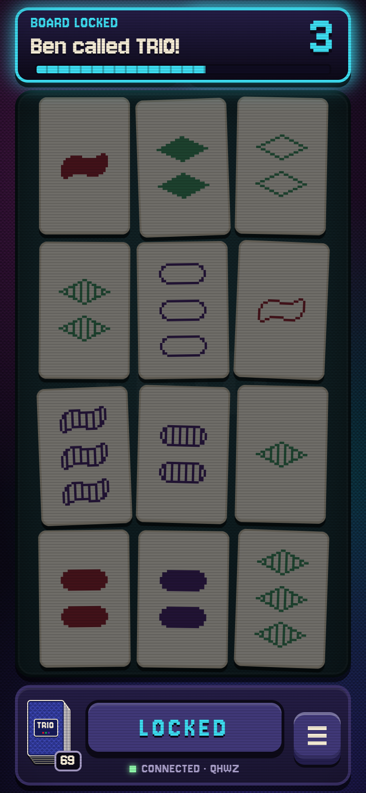

# Trio

A pixel-art card game about spotting sets, made for phones. Play head to head with a friend online, or train on your own and watch your reaction time drop.

**▶ Play: <https://cylfox.github.io/trio-game/>**

It's a static site on GitHub Pages plus one small room server on Cloudflare's free plan: no accounts, no ads.

<p>
  
  
  
  
</p>

## Features

- **Versus, online.** Two phones, one shared board. Press **SET!** to take the call: the other phone freezes while you pick your three cards against the clock.
- **Train, solo.** The same call flow with no opponent. A live spot timer measures how fast you find each set, and the results chart shows every attempt.
- **A deck you can watch.** Cards fly from the deck face down, flip, sway on the table and fly to whoever found the set.
- **Pixel art everywhere.** Hand-drawn card symbols redrawn on a 26×13 grid, the Jersey 10 pixel font, and a dark Balatro-inspired table.
- **Sound.** Synthesised chiptune effects for every action, with an on/off switch.
- **English and Spanish.** It follows your phone's language, and you can switch in the app.
- **Add to Home Screen.** It installs like an app and opens full-screen.

## How to play

### What's a set?

There are 81 cards. Each card has four features: **shape** (diamond, squiggle, oval), **colour** (red, green, purple), **number** (1, 2, 3) and **shading** (solid, striped, open).

Three cards make a **set** when, for each feature on its own, the three cards are **all the same or all different**. If two cards match on a feature and the third doesn't, it's not a set.

The lobby has worked examples and a "Show another" button for practice.

### Versus

1. One player taps **Create room** and shares the 4-letter code or invite link. The other taps **Join with code** or opens the link.
2. Twelve cards are dealt. When you spot a set, press **SET!**. The board freezes for your opponent, and you have 5 seconds to tap your three cards.
3. Scoring:
   - A right set scores **+3**.
   - A wrong set, or running out of time, costs **3** if you have at least 3 points, otherwise **1**.
   - Scores can go negative.
4. If there's no set on the table, three more cards are dealt automatically.
5. The game ends when the deck is empty and no set is left. The highest score wins.

### Train

Train uses the same flow: press **SET!**, then pick. Nothing is scored, so you're racing yourself. Pick a countdown of 3, 5 or 8 seconds, or turn it off.

- **Spot time** runs from the moment the new cards are face up to your SET! press.
- **Pick time** runs from SET! to your third card.

Wrong picks, timeouts and hint presses are all counted. Sets found with a hint don't count toward your records. Your personal bests are saved on your device.

## Playing with a friend

Each room lives on a small room server: a Cloudflare Worker with one [Durable Object](https://developers.cloudflare.com/durable-objects/) per room, in [`server/`](server/). Both phones connect to it over a WebSocket. The server runs the game and the call countdown, so neither phone has a head start, and it works on any network, 4G included.

Either phone can lock, switch apps or reload. The game keeps running, the countdown still runs out on time, and the player gets their seat and score back when they reconnect. The player who creates the room is its **host**: they start games, new games and rematches. A room is deleted after a day without play.

**If the room server can't be reached** (it's down, or out of its free daily quota), Create room makes a direct, peer-to-peer room instead: the creator's phone runs the game, and the phones talk over WebRTC, introduced by public [Nostr](https://nostr.com/) relays via [Trystero](https://github.com/dmotz/trystero). Its invite link ends in `#p-CODE`, so the other phone connects directly too, and the room shows "Direct connection". A typed code tries the server first, then a direct connection. A room never switches between the two.

> **Direct connections work best on the same Wi-Fi.** Some networks block phone-to-phone connections: many mobile carriers, corporate and university Wi-Fi, and some VPNs. To get past them, add a TURN relay to `TURN_SERVERS` in [`src/lib/net/trystero-transport.ts`](src/lib/net/trystero-transport.ts).

### Free plan

The room server fits in Cloudflare's Workers Free plan, which needs SQLite-backed Durable Objects. It allows 100,000 Durable Object requests and 100,000 rows written a day. A game costs about a hundred storage writes and a few dozen requests, so that's several hundred games a day. Past a limit, Cloudflare returns errors until the daily reset at 00:00 UTC, and new rooms fall back to direct connections.

### Abuse protection

The repo is public, so anyone can find the server's address.

- **Origins.** Only `https://cylfox.github.io` and local dev servers may create or join rooms (`ALLOWED_ORIGINS` in [`server/wrangler.jsonc`](server/wrangler.jsonc)). That stops other websites, but not scripts, which can send any origin.
- **Rate limits per IP.** 10 rooms created and 30 joins (connections) a minute. Past that, the server answers `429` with `Retry-After`, and the client falls back to a direct connection. The count is kept in this Worker's memory first, then in one small Durable Object per hashed IP, so it holds across Cloudflare's machines.
- **Per connection.** Messages over 4 KB or of the wrong shape are ignored. A flood (more than about 8 messages a second) or a run of bad messages closes the socket. A room holds at most 8 sockets and 2 players.
- **No bill.** On the free plan, exhausting a quota only makes the server error until the next day; it can't produce a bill.

## Development

Requires Node 24 or newer.

```sh
git clone https://github.com/cylfox/trio-game.git
cd trio-game
npm ci
npm run dev         # http://localhost:5173/trio-game/
npm run server:dev  # the room server on http://127.0.0.1:8787 (wrangler dev, no account needed)
npm test            # engine, protocol, room server, UI logic, audio, i18n and symbol tests (node --test)
npm run check       # svelte-check + tsc, strict, and the Worker's types
npm run build       # production build into dist/
npm run preview     # serve dist/ at /trio-game/
npm run symbols     # regenerate src/lib/symbol-data.ts from assets/pixel-symbols.json
npm run icons       # regenerate the icons in public/ (dev only; the outputs are committed)
```

To play against yourself on one computer, run `npm run server:dev` and `npm run dev`, then open `http://localhost:5173/trio-game/` and `http://127.0.0.1:5173/trio-game/`. They're different origins, so each gets its own player. Without `server:dev` running, rooms fall back to direct connections. Real phones need HTTPS, so test those on the Pages deployment.

### Room server

`VITE_ROOM_SERVER` tells the app where the room server is. Vite reads it at build time:

| File | Value |
|---|---|
| `.env.development` (`npm run dev`) | `ws://127.0.0.1:8787`, the local `npm run server:dev` |
| `.env.production` (`npm run build`, Pages) | `wss://trio-game.cylfox.workers.dev` |

Leave it empty for direct connections only, as before the room server. A `.env.development.local` file overrides it without being committed.

To deploy the Worker by hand:

```sh
npx wrangler login     # once, opens the browser
npm run server:deploy  # wrangler deploy: https://trio-game.cylfox.workers.dev
```

[`.github/workflows/deploy-server.yml`](.github/workflows/deploy-server.yml) redeploys it on pushes to `main` that touch `server/`, `src/lib/engine/` or `src/lib/net/`. It needs the repository secrets `CLOUDFLARE_API_TOKEN` (the "Edit Cloudflare Workers" token template) and `CLOUDFLARE_ACCOUNT_ID`; without them it skips. After changing `server/wrangler.jsonc`, run `npm run server:types` to refresh `server/worker-configuration.d.ts`.

The site itself deploys through [`.github/workflows/deploy.yml`](.github/workflows/deploy.yml) on every push to `main`, after the type check, tests and build pass.

**Stack:** Vite, Svelte 5, TypeScript (strict), Tailwind CSS v4, Cloudflare Workers and Durable Objects (Wrangler), and Trystero for direct connections.

| Path | What's in it |
|---|---|
| `src/lib/engine/` | The game engine. It's pure, has no dependencies, and takes time as an input. Every change returns `{state, events}`, and the events drive the animations. |
| `src/lib/net/` | Rooms and codes, the room rules (`room-core.ts`, shared by the server and P2P hosts), the host/guest protocol, transports (WebSocket, Trystero, in-memory), server-or-P2P choice (`open.ts`), rejoin and saved rooms. |
| `server/` | The room server: a Cloudflare Worker (routes, rate limits) and the `Room` Durable Object (sockets, storage, alarms). It imports the engine and room rules from `src/lib/`. |
| `src/game/` | Board layout, the event queue that turns engine events into animation steps, train stats and the spot clock. |
| `src/ui/` | The Svelte screens: lobby, game, results, rules, menu. |
| `src/lib/audio/` | The Web Audio synth and its sound recipes. No audio files. |
| `src/lib/i18n/` | Every user-facing string. `en.ts` is the source; `es.ts` must have the same keys, and the type check enforces it. |
| `src/lib/symbols.ts` | Draws the pixel-art card symbols. |
| `#debug` | Add `#debug` to the URL for a bare diagnostics screen. |

## Legacy

[`legacy/`](legacy/) holds the two earlier Angular versions, `angular-set-game` and `set-offline-trainer`, with their full git history. Trio's engine started from their logic, and its card symbols started from their hand-drawn SVGs. That folder is kept for reference, and the build ignores it.

## Support

If you enjoy Trio, you can buy me a coffee on [Ko-fi](https://ko-fi.com/cylfox). ☕

## License and credits

Trio is free software under the [GNU General Public License v3.0 or later](LICENSE).

- Font: [Jersey 10](https://fonts.google.com/specimen/Jersey+10) by The Soft Type Project Authors ([Sarah Cadigan-Fried](https://github.com/scfried/soft-type-jersey)), SIL Open Font License 1.1, self-hosted through Fontsource.
- Peer-to-peer: [Trystero](https://github.com/dmotz/trystero) (MIT). UI: [Svelte](https://svelte.dev/) (MIT). Build: [Vite](https://vite.dev/) and [Tailwind CSS](https://tailwindcss.com/) (MIT). Room server: [Wrangler](https://github.com/cloudflare/workers-sdk) (MIT or Apache 2.0).

Trio's matching rule comes from the card game SET®. Trio is an independent fan project. It isn't affiliated with or endorsed by the makers of SET.
