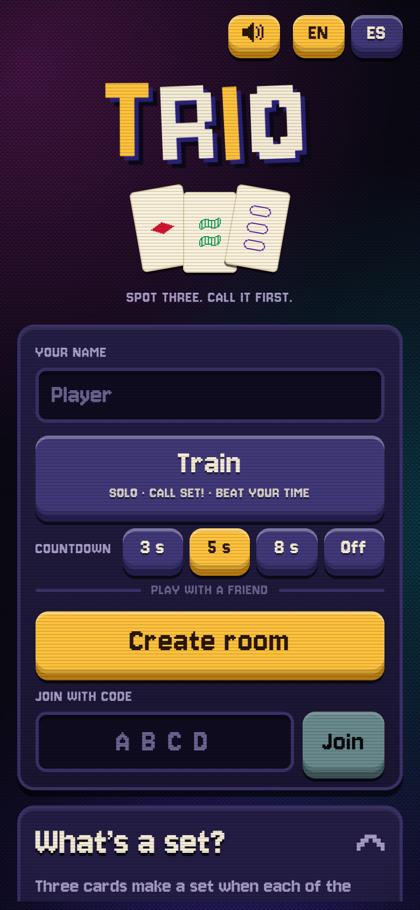
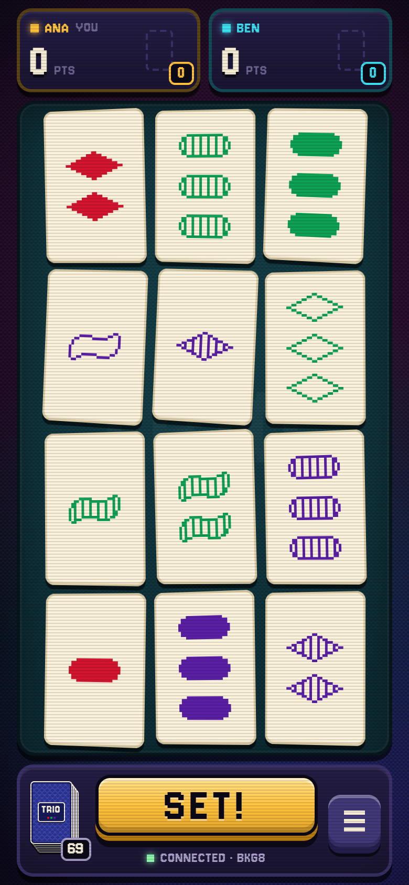
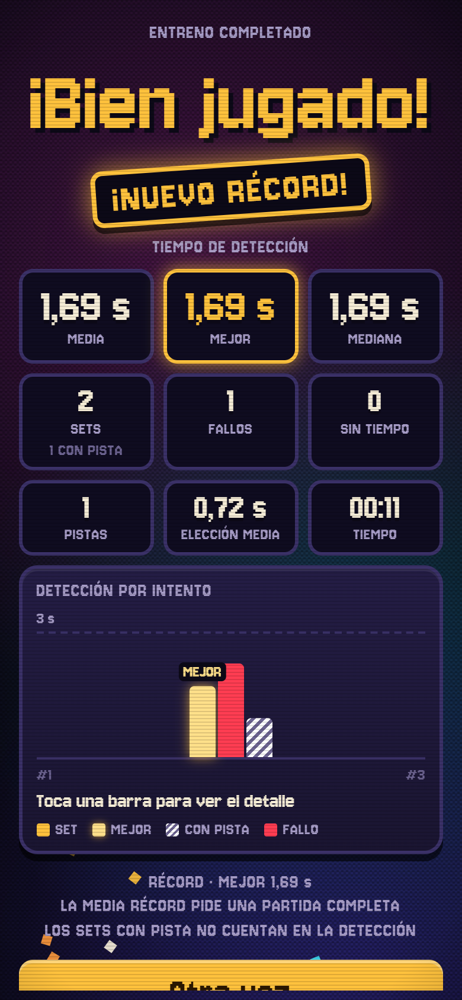

# Trio

A pixel-art card game about spotting sets, made for phones. Play head to head with a friend online, or train on your own and watch your reaction time drop.

**▶ Play: <https://cylfox.github.io/trio-game/>**

It's a static site on GitHub Pages: no server, no accounts, no ads. The two phones talk to each other directly.

<p>
  
  
  
  
</p>

## Features

- **Versus, online.** Two phones, one shared board. Press **SET!** to take the call: the other phone freezes while you pick your three cards against the clock.
- **Train, solo.** The same call flow with no opponent. A live spot timer measures how fast you find each set, and the results chart shows every attempt.
- **A deck you can watch.** Cards fly from the deck face down, flip, sway on the table and fly to whoever found the set.
- **Pixel art everywhere.** Hand-drawn card symbols redrawn on a 26×13 grid, the Jersey 10 pixel font, and a dark Balatro-inspired table.
- **Sound.** Synthesised chiptune effects for every action, with an on/off switch.
- **English and Spanish.** It follows your phone's language, and you can switch in the app.
- **Add to Home Screen.** It installs like an app and opens full-screen.

## How to play

### What's a set?

There are 81 cards. Each card has four features: **shape** (diamond, squiggle, oval), **colour** (red, green, purple), **number** (1, 2, 3) and **shading** (solid, striped, open).

Three cards make a **set** when, for each feature on its own, the three cards are **all the same or all different**. If two cards match on a feature and the third doesn't, it's not a set.

The lobby has worked examples and a "Show another" button for practice.

### Versus

1. One player taps **Create room** and shares the 4-letter code or invite link. The other taps **Join with code** or opens the link.
2. Twelve cards are dealt. When you spot a set, press **SET!**. The board freezes for your opponent, and you have 5 seconds to tap your three cards.
3. Scoring:
   - A right set scores **+3**.
   - A wrong set, or running out of time, costs **3** if you have at least 3 points, otherwise **1**.
   - Scores can go negative.
4. If there's no set on the table, three more cards are dealt automatically.
5. The game ends when the deck is empty and no set is left. The highest score wins.

### Train

Train uses the same flow: press **SET!**, then pick. Nothing is scored, so you're racing yourself. Pick a countdown of 3, 5 or 8 seconds, or turn it off.

- **Spot time** runs from the moment the new cards are face up to your SET! press.
- **Pick time** runs from SET! to your third card.

Wrong picks, timeouts and hint presses are all counted. Sets found with a hint don't count toward your records. Your personal bests are saved on your device.

## Playing with a friend

The player who creates the room is the **host**. Their phone runs the game, and the other phone only sends what its player does. If the host reloads, the room resumes. If the other player drops, they get their seat and score back when they reconnect.

Public [Nostr](https://nostr.com/) relays only introduce the two phones to each other (via [Trystero](https://github.com/dmotz/trystero)). After that, the game runs directly between the phones over WebRTC.

> **Same Wi-Fi works best for now.** Some networks block direct phone-to-phone connections: many mobile carriers, corporate and university Wi-Fi, and some VPNs. For example, a phone on 4G can't reach a PC on home Wi-Fi. Fixing that needs a TURN relay. To add one, list it in `TURN_SERVERS` in [`src/lib/net/trystero-transport.ts`](src/lib/net/trystero-transport.ts).

## Development

Requires Node 24 or newer.

```sh
git clone https://github.com/cylfox/trio-game.git
cd trio-game
npm ci
npm run dev       # http://localhost:5173/trio-game/
npm test          # engine, protocol, UI logic, audio, i18n and symbol tests (node --test)
npm run check     # svelte-check + tsc, strict
npm run build     # production build into dist/
npm run preview   # serve dist/ at /trio-game/
npm run symbols   # regenerate src/lib/symbol-data.ts from assets/pixel-symbols.json
npm run icons     # regenerate the icons in public/ (dev only; the outputs are committed)
```

To play against yourself on one computer, open `http://localhost:5173/trio-game/` and `http://127.0.0.1:5173/trio-game/`. They're different origins, so each gets its own player. Real phones need HTTPS, so test those on the Pages deployment. Every push to `main` deploys through [`.github/workflows/deploy.yml`](.github/workflows/deploy.yml), after the type check, tests and build pass.

**Stack:** Vite, Svelte 5, TypeScript (strict), Tailwind CSS v4 and Trystero.

| Path | What's in it |
|---|---|
| `src/lib/engine/` | The game engine. It's pure, has no dependencies, and takes time as an input. Every change returns `{state, events}`, and the events drive the animations. |
| `src/lib/net/` | Rooms and codes, the host/guest protocol, the `Transport` interface (Trystero and in-memory), rejoin and saved rooms. |
| `src/game/` | Board layout, the event queue that turns engine events into animation steps, train stats and the spot clock. |
| `src/ui/` | The Svelte screens: lobby, game, results, rules, menu. |
| `src/lib/audio/` | The Web Audio synth and its sound recipes. No audio files. |
| `src/lib/i18n/` | Every user-facing string. `en.ts` is the source; `es.ts` must have the same keys, and the type check enforces it. |
| `src/lib/symbols.ts` | Draws the pixel-art card symbols. |
| `#debug` | Add `#debug` to the URL for a bare diagnostics screen. |

## Legacy

[`legacy/`](legacy/) holds the two earlier Angular versions, `angular-set-game` and `set-offline-trainer`, with their full git history. Trio's engine started from their logic, and its card symbols started from their hand-drawn SVGs. That folder is kept for reference, and the build ignores it.

## Support

If you enjoy Trio, you can buy me a coffee on [Ko-fi](https://ko-fi.com/cylfox). ☕

## License and credits

Trio is free software under the [GNU General Public License v3.0 or later](LICENSE).

- Font: [Jersey 10](https://fonts.google.com/specimen/Jersey+10) by The Soft Type Project Authors ([Sarah Cadigan-Fried](https://github.com/scfried/soft-type-jersey)), SIL Open Font License 1.1, self-hosted through Fontsource.
- Peer-to-peer: [Trystero](https://github.com/dmotz/trystero) (MIT). UI: [Svelte](https://svelte.dev/) (MIT). Build: [Vite](https://vite.dev/) and [Tailwind CSS](https://tailwindcss.com/) (MIT).

Trio's matching rule comes from the card game SET®. Trio is an independent fan project. It isn't affiliated with or endorsed by the makers of SET.
